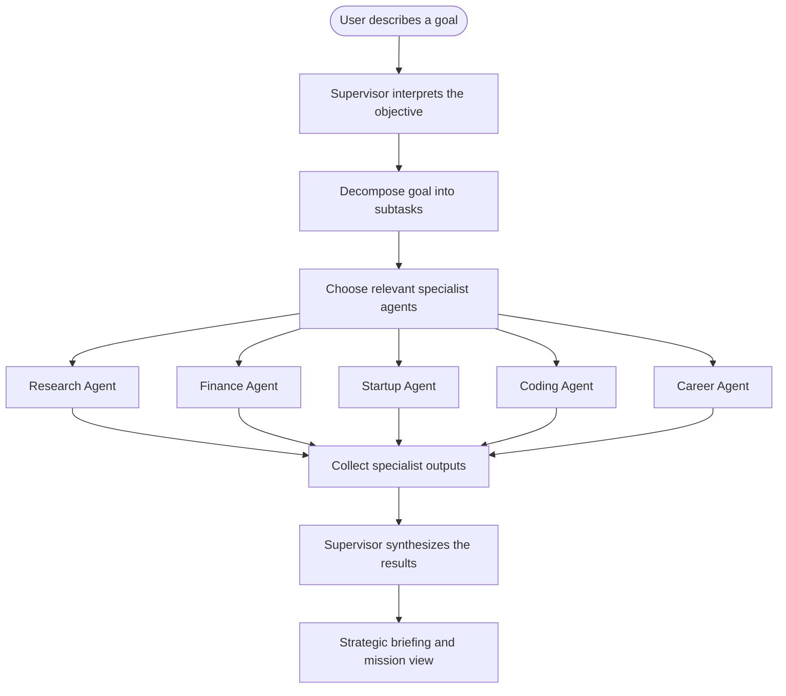
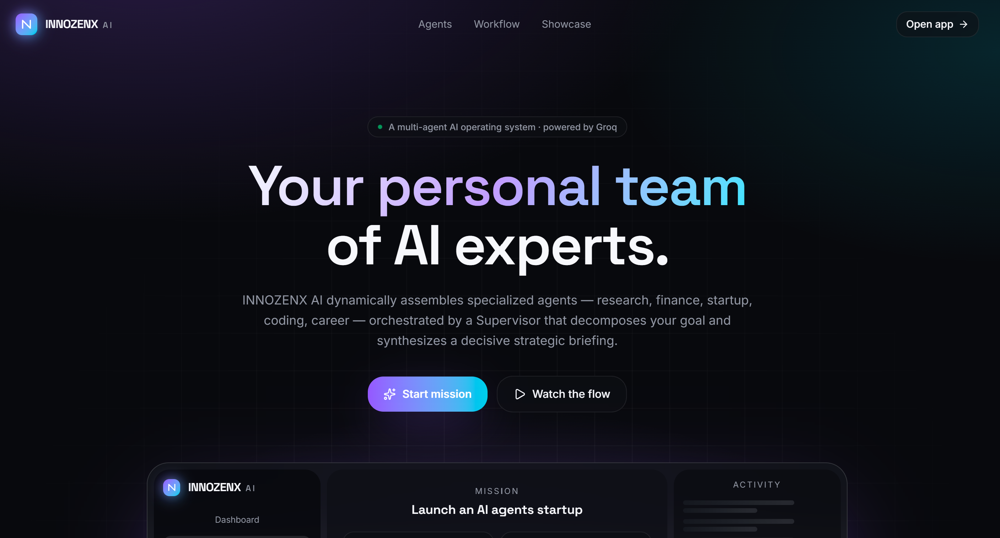
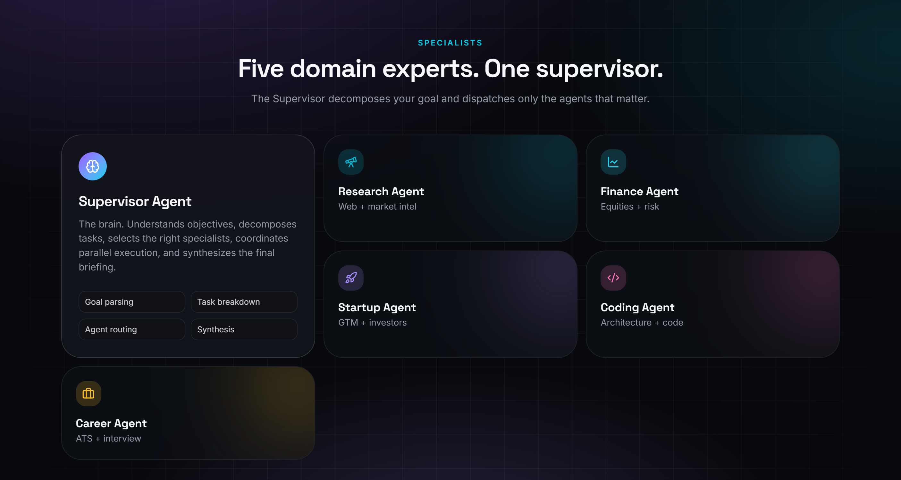
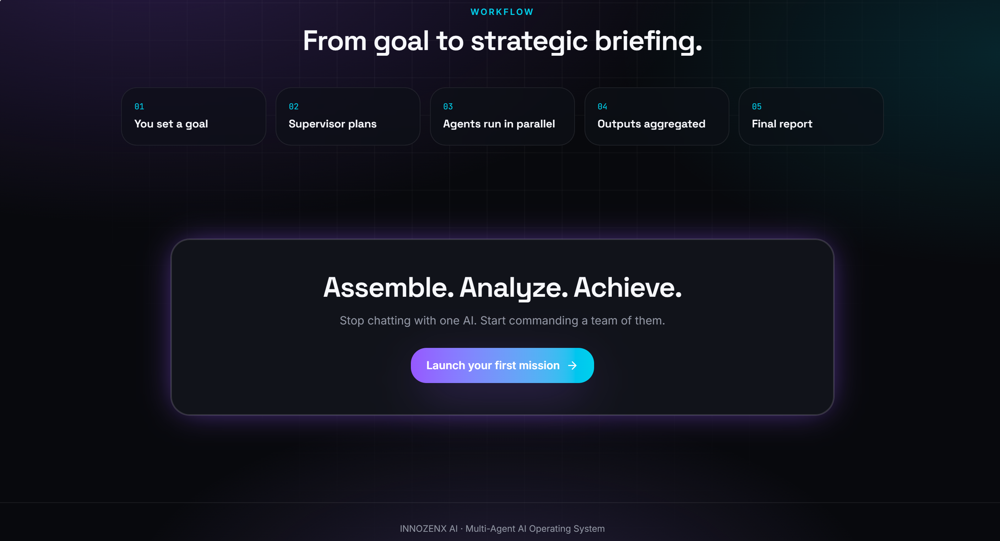
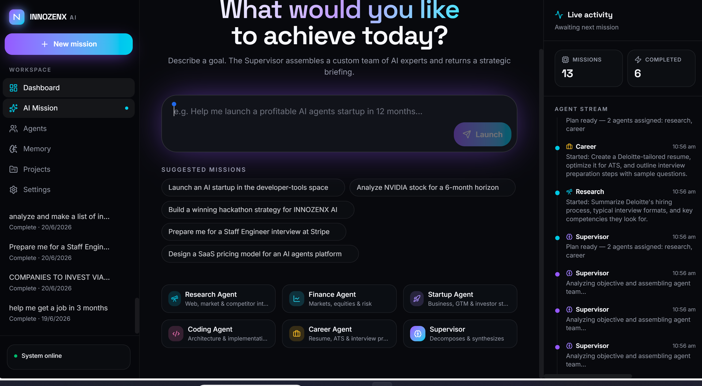
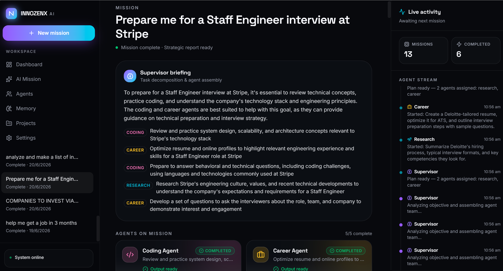
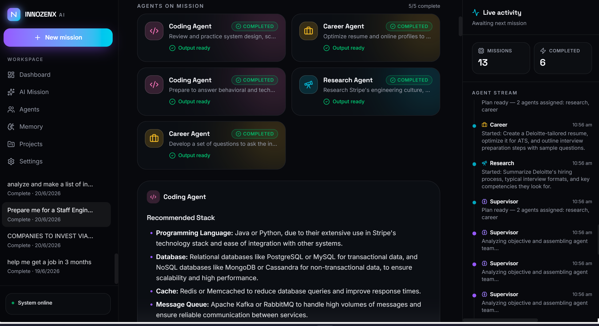
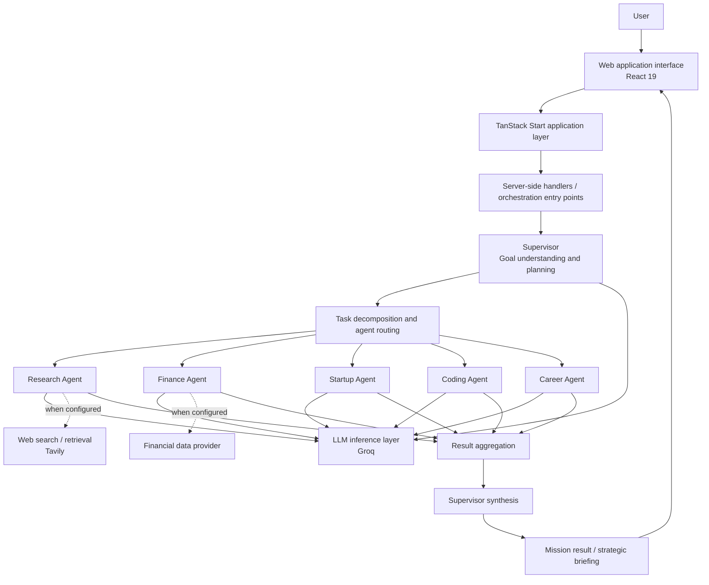
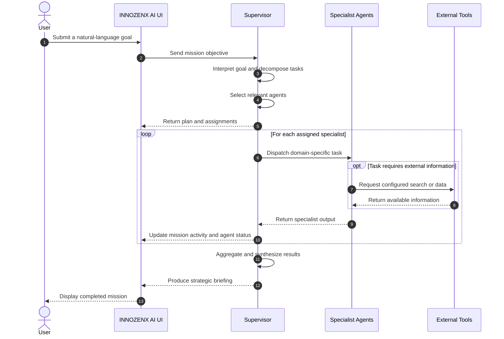

<div align="center">

# INNOZENX AI

### Assemble. Analyze. Achieve.

**Your personal team of AI experts — coordinated by one Supervisor.**

INNOZENX AI turns a high-level goal into a coordinated multi-agent mission. A Supervisor interprets the objective, selects the specialist agents that matter, coordinates their work, and brings their outputs together into a strategic briefing.

[](https://github.com/GURUTEJGANAPURAPU/Innozenx-AI)
[](LICENSE)
[](https://groq.com/)

</div>

---

## Contents

- [Why INNOZENX AI?](#why-innozenx-ai)
- [How it works](#how-it-works)
- [Specialist agents](#specialist-agents)
- [Product capabilities](#product-capabilities)
- [Screenshots](#screenshots)
- [System architecture](#system-architecture)
- [Mission execution sequence](#mission-execution-sequence)
- [Technology](#technology)
- [Getting started](#getting-started)
- [Environment configuration](#environment-configuration)
- [Development commands](#development-commands)
- [Security and responsible use](#security-and-responsible-use)
- [Project status and roadmap](#project-status-and-roadmap)
- [Contributing](#contributing)
- [License](#license)

---

## Why INNOZENX AI?

Most AI interfaces begin and end with a single conversation. Real-world goals, however, often need several kinds of expertise: research, technical planning, financial evaluation, startup strategy, and career preparation.

**INNOZENX AI is designed around coordinated work rather than one-off prompts.** Instead of manually choosing a different assistant for every subtask, a user describes the outcome they want. The Supervisor breaks that outcome into smaller tasks and assigns relevant work to a focused group of agents.

### The idea

> Stop chatting with one AI. Start coordinating a team of them.

### What makes the approach different?

- **Goal-first interaction:** start with the outcome you want to achieve, not with a long list of manual prompts.
- **Supervisor-led planning:** translate a broad objective into an actionable mission plan.
- **Specialist execution:** route subtasks to domain-focused agents rather than using every agent for every mission.
- **Consolidated output:** bring specialist results back into a single mission view and strategic briefing.
- **Visible orchestration:** follow mission progress through agent cards, completion states, and the activity stream.

---

## How it works

A mission follows a simple orchestration loop:

1. **Describe a goal.** Enter a natural-language objective, such as preparing for a Staff Engineer interview or evaluating a business opportunity.
2. **Supervisor analyses the objective.** It interprets the goal, identifies the work required, and creates a task breakdown.
3. **Select the right specialists.** The Supervisor assigns only the agents relevant to the mission.
4. **Run the specialist tasks.** Each agent works on its assigned part of the objective. Depending on the task and configured integrations, this can include research or domain-specific analysis.
5. **Aggregate the outputs.** Results are brought back into the mission workspace.
6. **Review the strategic briefing.** The user can inspect the Supervisor's plan, assigned work, agent outputs, and mission activity.



*The diagram represents the product's orchestration model. The agents dispatched for a mission depend on the user's goal; all five agents are not necessarily invoked every time.*

---

## Specialist agents

INNOZENX AI is organised around five domain specialists and a central Supervisor.

| Agent | Focus | Example responsibilities |
|---|---|---|
| **Supervisor Agent** | Planning and orchestration | Goal interpretation, task decomposition, agent selection, coordination, and synthesis of the final briefing. |
| **Research Agent** | Web and market intelligence | Gather and organise relevant information, investigate companies or markets, and summarise findings. |
| **Finance Agent** | Financial analysis | Support company and investment research, compare financial considerations, and surface risks. |
| **Startup Agent** | Startup strategy | Explore business ideas, positioning, go-to-market considerations, and investor-oriented planning. |
| **Coding Agent** | Software engineering | Help with technical architecture, technology choices, implementation planning, and engineering problem-solving. |
| **Career Agent** | Career development | Support resume and profile optimisation, job research, interview preparation, and career planning. |

The Supervisor acts as the coordination layer. Specialist agents focus on their assigned domain, while the Supervisor keeps the overall mission aligned with the original objective.

---

## Product capabilities

### 1. Natural-language mission launch

Start a mission by describing the outcome in plain language. The mission interface also presents example prompts to help users get started.

### 2. Dynamic agent orchestration

The Supervisor analyses the request and assembles a relevant team. This keeps the workflow focused on the actual goal instead of dispatching every specialist by default.

### 3. Mission workspace

The application workspace brings core areas together, including:

- **Dashboard:** overview of missions, completion indicators, and recent activity.
- **AI Mission:** launch and review a goal-driven mission.
- **Agents:** view the specialist-agent lineup.
- **Memory:** a dedicated workspace area for memory-related functionality.
- **Projects:** a dedicated area for project-related work.
- **Settings:** application configuration and preferences.

The exact capabilities available within each workspace area depend on the current implementation and configuration.

### 4. Agent execution cards

See which specialists have been assigned to a mission and whether their work is pending, running, or completed. Completed agent cards indicate that an output is ready for review.

### 5. Supervisor briefing

Review the Supervisor's task decomposition and understand why particular agents were assigned. The briefing provides a mission-level explanation before or alongside the detailed specialist outputs.

### 6. Live activity stream

Follow orchestration events and mission activity from the workspace. The activity area provides context about planning, agent assignment, and progress.

### 7. Mission history and progress overview

The interface displays mission and completion counts, along with previously created missions, making it easier to revisit earlier work.

---

## Screenshots

The screenshots below show the product's interface and a sample mission. They are included as product snapshots; the text and results shown inside them are illustrative examples, not guarantees of real-world outcomes.

### Landing page

The product introduction presents INNOZENX AI as a personal team of AI experts, with entry points to start a mission and explore the workflow.



### Five domain experts and the Supervisor

The agent overview introduces the Supervisor alongside Research, Finance, Startup, Coding, and Career specialists.



### From goal to strategic briefing

The workflow overview communicates the high-level mission lifecycle: goal, Supervisor planning, agent execution, output aggregation, and final report.



### Mission dashboard

The mission workspace combines the goal input, suggested missions, specialist shortcuts, and a live activity panel.



### Supervisor briefing — sample mission

This example shows a Staff Engineer interview preparation mission. The Supervisor identifies relevant coding, career, and research tasks and explains the assignments.



### Agent results and activity stream

The completed mission view displays specialist execution cards, ready-to-review outputs, mission counts, and a chronological activity stream.



---

## System architecture

The following is a **logical architecture view** of the product. It describes the responsibilities and interaction boundaries; it is not intended to replace the concrete source-code layout or claim that every optional provider is enabled in every deployment.



### Architecture responsibilities

| Layer | Responsibility |
|---|---|
| **Presentation** | Mission input, workspace navigation, agent cards, status indicators, and result rendering. |
| **Application layer** | Handles the application request lifecycle and server-side execution boundaries. |
| **Supervisor** | Understands the goal, creates the plan, chooses agents, and synthesizes the response. |
| **Specialist agents** | Perform focused domain tasks and return structured or readable outputs. |
| **Model provider** | Supplies language-model inference. The project has been designed around Groq-hosted models. |
| **External tools** | Optional integrations such as web search and financial data, subject to API keys and implementation configuration. |
| **Aggregation and output** | Combines specialist results into a mission-level briefing for the user. |

---

## Mission execution sequence

This sequence diagram expands the mission lifecycle into the main interactions between the user, Supervisor, specialists, and external tools.



---

## Technology

The project is built around a modern TypeScript web application architecture and an LLM-powered agent orchestration layer.

| Technology / service | Role in the project |
|---|---|
| **React 19** | Component-based user interface. |
| **TanStack Start** | Full-stack application framework and server-side application foundation. |
| **TypeScript** | Type-safe application development. |
| **Groq** | LLM inference provider used by the AI workflow. |
| **Llama 3.3 70B Versatile** | Model previously used for the project's language-model workflow; confirm the active model configured in your environment. |
| **Tavily** | Web search / information retrieval integration for research workflows, when configured. |
| **Finance APIs** | Financial data integration points for finance-oriented workflows, depending on the provider configured in the code. |

> **Implementation note:** Check the current `package.json`, server routes, and environment-variable reads before publishing a definitive dependency or provider list. The table describes the project's known design stack and integrations; optional services may require separate configuration.

---

## Getting started

### Prerequisites

- Node.js and npm installed. Use a Node.js version supported by the dependencies in `package.json`.
- A Groq API key for model access.
- A Tavily API key if the research workflow in your current build uses Tavily.
- Any additional provider credentials required by the integrations enabled in your source code.

### 1. Clone the repository

```bash
git clone https://github.com/GURUTEJGANAPURAPU/Innozenx-AI.git
cd Innozenx-AI
```

### 2. Install dependencies

```bash
npm install
```

### 3. Configure environment variables

Create a local environment file in the project root. For example, create `.env.local` and add the credentials required by your implementation:

```env
GROQ_API_KEY=your_groq_api_key
TAVILY_API_KEY=your_tavily_api_key
FINNHUB_API_KEY=
TWELVE_DATA_API_KEY=
FMP_API_KEY=
MARKETAUX_API_KEY=
```

If the code uses different variable names, use the exact names referenced by the server-side code. Add any finance-provider credentials only when that provider is implemented and enabled.

**Never commit `.env`, `.env.local`, API keys, service tokens, or other secrets.** Keep local environment files excluded through `.gitignore`.

### 4. Start the development server

```bash
npm run dev
```

Open the local URL printed in the terminal by the development server.

### 5. Build for production

```bash
npm run build
```

To see all scripts available in this specific checkout, run:

```bash
npm run
```

Deployment commands and hosting configuration depend on the scripts and adapter configured in the repository.
---

## Security and responsible use

- Keep provider API keys on the server. Do not hard-code secrets in components or commit them to Git.
- Validate and constrain user inputs before passing them to model or tool calls.
- Treat external search results and model-generated content as untrusted until reviewed.
- Avoid sending confidential, personal, or regulated information unless the deployment has appropriate controls and a clear legal basis.
- Review financial, career, business, and technical recommendations independently before acting on them.
- AI-generated content can be inaccurate, incomplete, outdated, or biased. It should support human judgement, not replace it.

INNOZENX AI is an informational productivity tool. It does not guarantee investment performance, business success, interview outcomes, or the correctness of generated code or research.

---

## Contributing

Contributions, suggestions, bug reports, and feature ideas are welcome.

1. Fork the repository.
2. Create a focused branch: `git checkout -b feat/your-feature`.
3. Make and test your changes.
4. Commit with a descriptive message.
5. Open a pull request with a clear explanation and relevant screenshots for UI changes.

For larger changes, open an issue first to discuss the intended approach.

---

## License

This project is licensed under the [MIT License](LICENSE).

---

<div align="center">

**INNOZENX AI — Assemble. Analyze. Achieve.**

Built to turn ambitious goals into coordinated action.

[View the repository](https://github.com/GURUTEJGANAPURAPU/Innozenx-AI)

</div>
